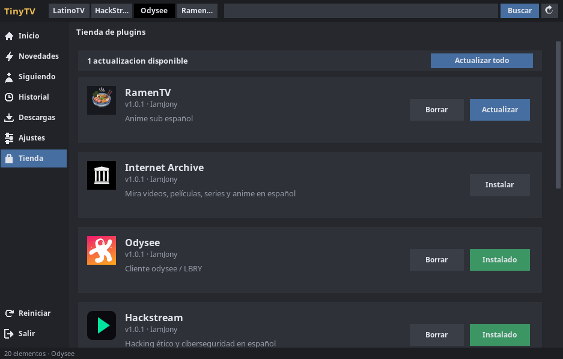
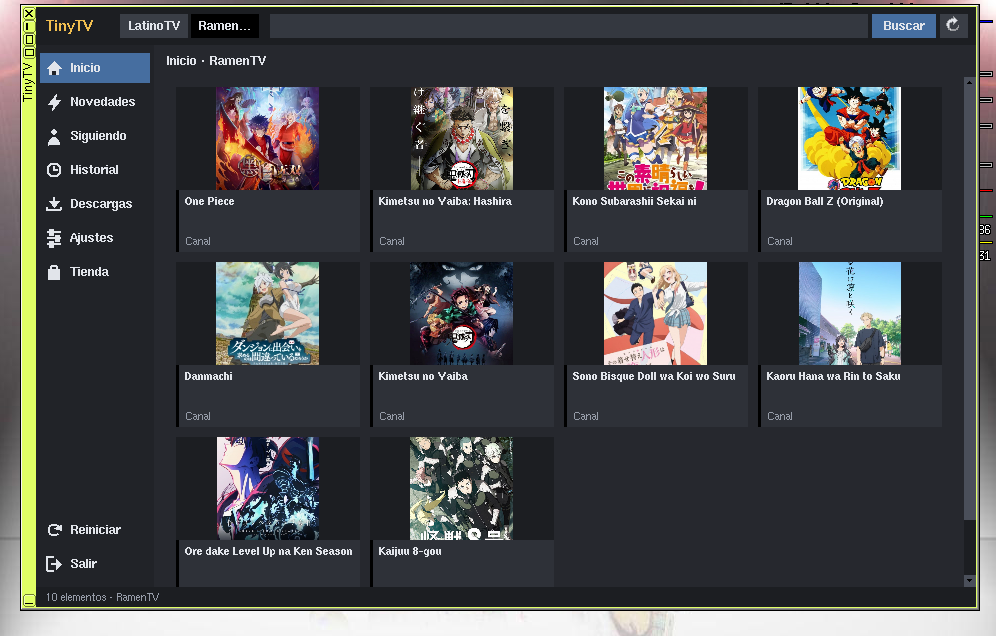
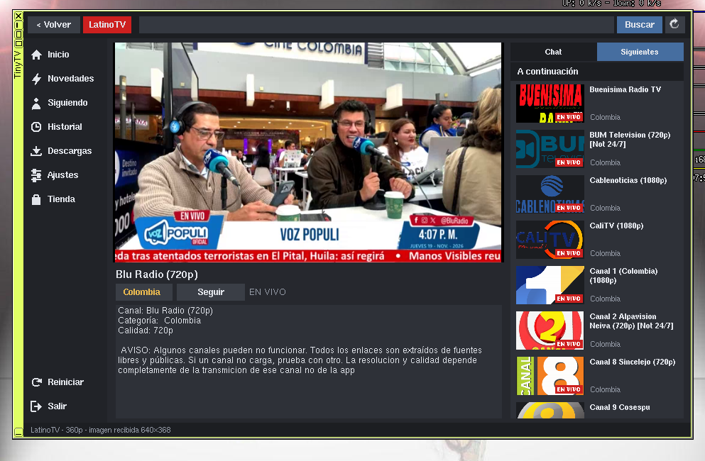
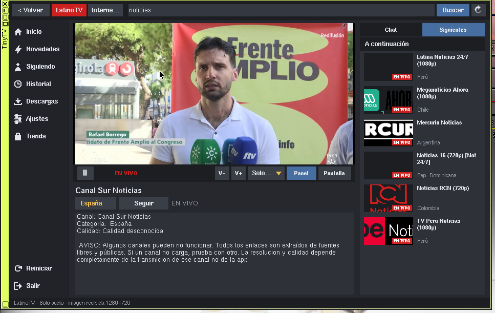

# TinyTV
**TinyTV** es un *fork* de **[Sanson](https://gitlab.com)** que incorpora un **sistema de plugins externos** y una **tienda integrada** para instalar, actualizar y gestionar plataformas de *streaming* adicionales (LatinoTV, RamenTV, Internet Archive, entre otras).

A diferencia del proyecto original, TinyTV apuesta por un enfoque más simple y ligero:

* **Enfoque en compatibilidad:** Prioriza el soporte para plataformas no disponibles en Sanson por encima de incluir todas sus funciones.
* **Base estable:** Está construido sobre una versión anterior de Sanson de forma intencional, ya que no busca estar a la vanguardia en novedades, sino mantener una estructura liviana.


<p align="center">
  
  
  
  
</p>

Más capturas en el directorio [`capturas/`](capturas/).

---

## Índice

- [Novedades TinyTV](#novedades-tinytv)
- [Características heredadas de Sansón](#características-heredadas-de-sansón)
- [¿Funcionará bien en mi equipo?](#funcionará-bien-en-mi-equipo)
- [Instalar](#instalar)
  - [En FLinux / Tiny Core](#en-flinux--tiny-core)
  - [En Debian / Ubuntu](#en-debian--ubuntu)
- [Solución de problemas de TinyTV](#solución-de-problemas-de-tinytv)
  - [Los plugins no funcionan o no cargan](#los-plugins-no-funcionan-o-no-cargan)
  - [Rendimiento lento o video entrecortado](#rendimiento-lento-o-video-entrecortado)

---

## Novedades TinyTV

- **Arquitectura de plugins externos dinámicos:** ya no depende de plataformas fijas compiladas en el binario. TinyTV escanea e inicializa los plugins instalados en `~/.config/tinytv/plugins` (y en el directorio del sistema), permitiendo añadir nuevas fuentes o actualizarlas de forma independiente.
- **Tienda de plugins integrada:** desde la barra lateral (**Tienda**) se puede explorar el catálogo remoto, descargar e instalar plugins en un clic, ver versiones locales frente a disponibles y desinstalarlos.
- **Autenticación por cookies ampliada:** en **Ajustes** se pueden pegar sesiones tanto en formato encabezado HTTP (`Cookie: ...` / `clave=valor`) como en formato **Netscape HTTP Cookie File** (`cookies.txt`).
- **Incluye plugins base y soporte comunitario:** compatible con YouTube, YouTube Music (Música), Twitch, Kick, Internet Archive, LatinoTV y otros plugins del repositorio de la comunidad.

---

## Características heredadas de Sansón

- Portada, búsqueda (videos y canales) y exploración de canales por plataforma.
- Reproducción de videos y directos con selección de las **calidades que entrega cada plataforma**.
- Botón **Idioma** en los videos de YouTube: selección de pista de audio (por defecto suena el original, no el doblaje automático) y **subtítulos**, incluidos los generados automáticamente.
- Salto automático de anuncios en Twitch.
- **Chat en vivo** de los directos con emotes de cada plataforma y envío de mensajes con sesión iniciada.
- **Chat de repetición** en videos grabados (VODs) sincronizado con la reproducción.
- **Comentarios** en videos de YouTube y publicación con sesión iniciada.
- Controles sobre el video (pausa, barra de avance, volumen, calidad, pantalla completa) que aparecen al mover el ratón y se ocultan solos. Saltos de 10 segundos con las flechas, recarga junto a **Buscar** (o `F5`) y botón **Volver** arriba a la izquierda.
- Diseño pensado también para pantallas de 800×600 (netbooks): la ventana se adapta a pantallas pequeñas y en ancho reducido la barra lateral pasa a modo solo íconos.
- Reconexión automática si el flujo se traba y ajuste automático de calidad si vuelve a ocurrir.
- Canales seguidos e historial guardados localmente en el equipo.
- Pestaña **Música** (YouTube Music), solo audio y sin anuncios:
  - Canciones, álbumes y artistas (con opción de seguir artistas).
  - Portada del álbum y **letra sincronizada** al costado (clic en cualquier línea para saltar a ese instante).
  - **Cola de reproducción** editable (clic derecho para reproducir a continuación o añadir a la cola; subir, bajar, quitar o vaciar), modo aleatorio, repetir y **radio** continua.
  - Reproducción en segundo plano mientras navegas; el botón **Sonando** vuelve a la canción actual.
  - Respaldo automático en SoundCloud si YouTube no entrega el audio de una pista.
- **Descargas** integradas sin dependencias externas (`yt-dlp` ni `ffmpeg`): video con audio o solo audio, selección de calidad, nombre, carpeta de destino y descargas paralelas por múltiples conexiones (1 a 8 hilos).

---

## ¿Funcionará bien en mi equipo?

Depende del equipo. Reproducir video requiere dibujar cuadros continuamente en pantalla, lo que depende sobre todo del procesador y de la aceleración gráfica.

Como referencia en el equipo de pruebas original (AMD V120 de un núcleo, 744 MB de RAM, video sin aceleración), un directo a 360p con el modo de video liviano activado usa cerca de la mitad del procesador. En equipos más modestos puede ir lento o entrecortado.

Si va lento:

- Elige una calidad más baja en **Ajustes** (`360p` o `160p`).
- Activa el **video liviano** en **Ajustes** (muestra la mitad de los cuadros para aliviar la CPU).
- Mantén la ventana en su tamaño normal en lugar de pantalla completa.

---

## Instalar

### En FLinux / Tiny Core

1. Instala las dependencias base: `fltk-1.3`, `curl`, `mplayer-cli`, `libwebp1` y `gcc_libs`.
2. Carga el paquete `.tcz` generado en `tcz/`:

```sh
tce-load -i ./sanson.tcz
```

### En Debian / Ubuntu

#### Opción 1: Instalación desde paquete `.deb` (Recomendada)
Descarga el paquete precompilado desde la sección de [Releases](https://github.com/IamJony/tinytv/releases) e instálalo:

```bash
wget https://github.com/IamJony/tinytv/releases/download/v1.0.0/tinytv_1.0.0_amd64.deb
sudo apt install ./tinytv_1.0.0_amd64.deb
```

#### Opción 2: Compilar y empaquetar desde el código fuente
1. Instala las dependencias de compilación necesarias:
```bash
sudo apt update
sudo apt install build-essential git libcurl4-openssl-dev libfltk1.3-dev libwebp-dev mplayer
```
2. Concede permisos de ejecución al script y ejecútalo para compilar y generar el paquete `.deb`:
```bash
chmod +x make_deb.sh
./make_deb.sh
```
3. Instala el paquete generado en `/tmp`:
```bash
sudo apt install /tmp/tinytv_1.0.0_amd64.deb
```

---

## Solución de problemas de TinyTV

*(Referencia externa: `docs/solucion_de_problemas_de_tinytv.md`)*

### Los plugins no funcionan o no cargan

- **Verifica `comun.js` en la carpeta de configuración:** si ningún plugin funciona o aparece error al cargar, comprueba que `comun.js` exista dentro de `~/.config/tinytv/plugins/`:
  ```bash
  ls -la ~/.config/tinytv/plugins/comun.js
  ```
- **Copia `comun.js` desde una ruta local disponible:** si falta, cópialo desde el directorio del sistema o del código fuente:
  ```bash
  mkdir -p ~/.config/tinytv/plugins
  cp -f /usr/share/tinytv/plugins/comun.js ~/.config/tinytv/plugins/comun.js
  ```
- **Descarga `comun.js` si no está presente localmente:**
  ```bash
  mkdir -p ~/.config/tinytv/plugins
  curl -fsSL "https://raw.githubusercontent.com/IamJony/tinytv/refs/heads/main/plugins/comun.js" -o ~/.config/tinytv/plugins/comun.js
  ```

### Rendimiento lento o video entrecortado

- Selecciona una calidad más baja en **Ajustes** (`360p` o `160p`).
- Activa el **video liviano** en **Ajustes** para reducir el consumo de CPU.
- Mantén la ventana en tamaño normal en lugar de pantalla completa en equipos con poca potencia gráfica.
